<div align="center">

# Vehicle Detection in Adverse Weather Conditions

**YOLO12-powered vehicle detection that stays reliable in clear, foggy, night and rainy conditions.**

[](https://www.python.org/)
[](https://pytorch.org/)
[](https://docs.ultralytics.com/)
[](https://opencv.org/)
[](https://numpy.org/)

[](LICENSE)
[](https://creativecommons.org/licenses/by/4.0/)
[](https://www.kaggle.com/datasets/mingshen0118/bard-vehicle-detection)
[](#-dashcam-app)

[Dataset](#-dataset--bard) · [Results](#-results) · [Quick Start](#-getting-started) · [Pipeline](#-pipeline-run-in-order) · [Dashcam](#-dashcam-app) · [License](#-license)

</div>

---

A complete, reproducible project: merge four driving datasets into one weather-organized
YOLO dataset, balance and split it, train and benchmark YOLO12 variants, then deploy the
best model as an ONNX export or a real-time dashcam desktop app.

## Features

- **6 vehicle classes** — Bicycle, Bus, Car, Motorcycle, Train, Truck (persons and other non-vehicle classes removed)
- **Weather-organized BARD dataset** — BDD100K + ACDC + RTTS + DAWN merged into one YOLO-format dataset
- **Class-balanced sampling & splitting** — 400 instances per class per weather, instance-balanced 70/20/10 train/val/test split
- **Targeted augmentation** — minority classes (train, motorcycle) filled with cropped + augmented instances
- **Reproducible benchmarks** — YOLO12 n/s/m/x comparison, overall and per-weather metrics, post-NMS tuning
- **Deployment ready** — ONNX export + Tkinter dashcam app with live vehicle count, FPS and recording

## Tech Stack

| Purpose | Technology |
|---|---|
| Detection model | [Ultralytics YOLO12](https://docs.ultralytics.com/) (PyTorch) |
| Image processing & augmentation | OpenCV, Pillow, NumPy |
| Dataset configs & reports | PyYAML, tabulate |
| Visualization | Matplotlib |
| Desktop GUI | Tkinter |
| Model export | ONNX / ONNX Runtime |

## Dataset — BARD

BARD combines four driving datasets into one adverse-weather vehicle detection dataset
(**~12 GB**, YOLO format, CC-BY-4.0):

| Source | Contribution |
|---|---|
| **BDD100K** (Berkeley DeepDrive) | Large-scale clear / night / rain driving scenes |
| **ACDC** (Adverse Conditions Dataset with Correspondences) | Fog / night / rain / snow, plus clear reference images |
| **RTTS** (Real-world Task-driven Testing Set) | Real hazy (fog) scenes |
| **DAWN** (Detection in Adverse Weather Nature) | Fog / rain / snow / sand-storm scenes |

> **Download:** [GitHub](https://github.com/mingshenchea-cmyk/BARD-Vehicle-Detection) · [Kaggle](https://www.kaggle.com/datasets/mingshen0118/bard-vehicle-detection)

Classes (YOLO label ids):

| Id | Class | Id | Class |
|---|---|---|---|
| 0 | Bicycle | 3 | Motorcycle |
| 1 | Bus | 4 | Train |
| 2 | Car | 5 | Truck |

Images are grouped by weather: `clear`, `fog`, `night`, `rain`, `sand`, `snow`.
The balanced training split uses **clear / fog / night / rain**; sand and snow remain
in the merged dataset but are not sampled into the split.

Sample scenes from the dataset:

| | | | |
|---|---|---|---|
| 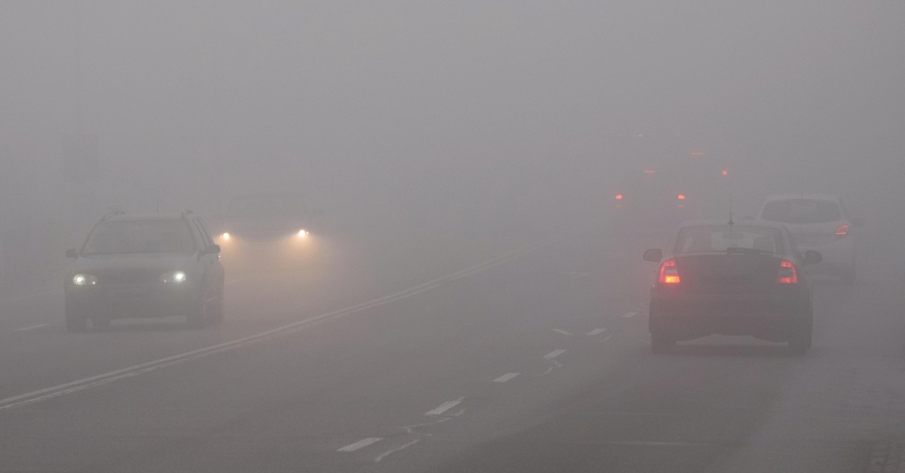 | 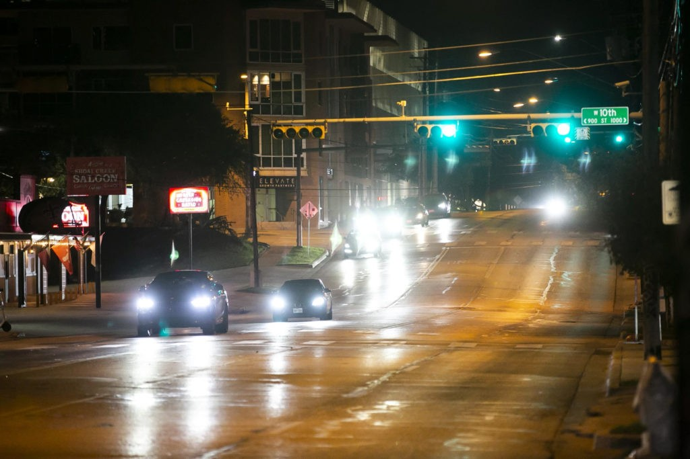 | 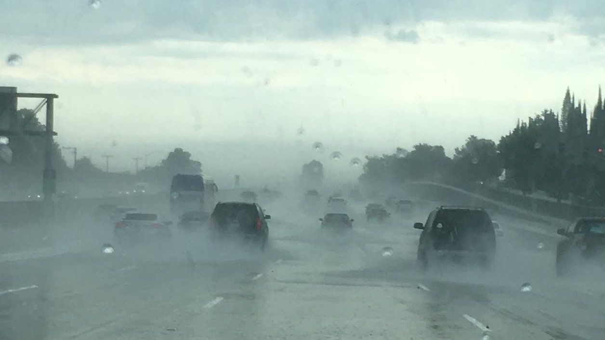 | 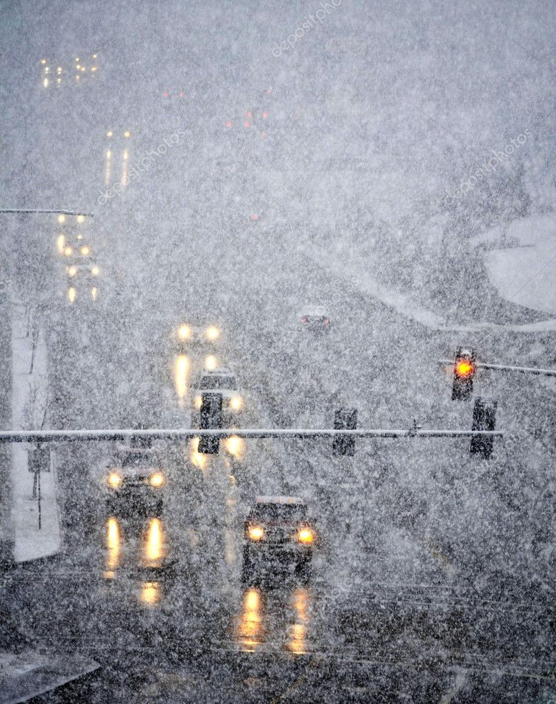 |
| Fog | Night | Rain | Snow storm |
| 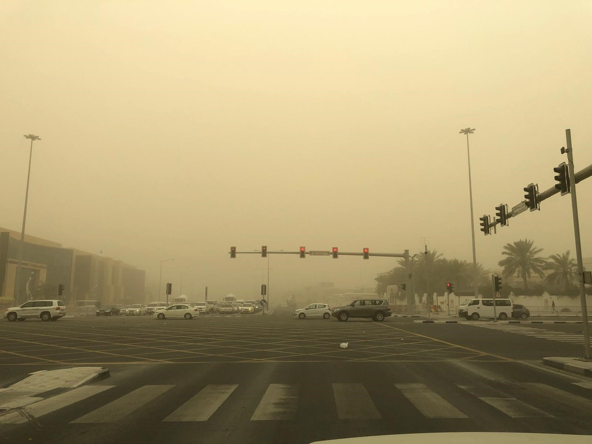 | 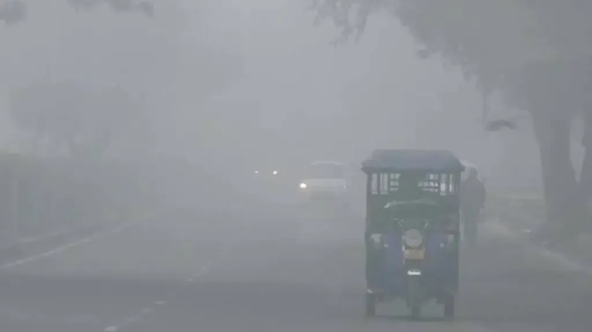 | 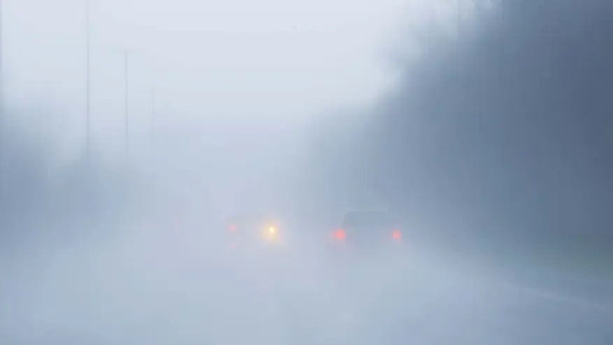 | 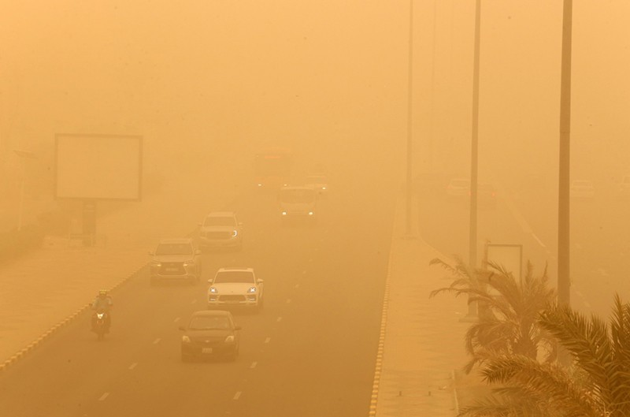 |
| Dust | Haze | Mist | Sand storm |

*(Haze and mist are grouped under `fog`, dust and sand storm under `sand` in the pipeline.)*

## Results

Trained on Google Colab (Tesla T4), COCO-pretrained weights, `imgsz=480`, early stopping
(`patience=5`). **YOLO12s performed best** and is released as `best.pt`.

Model comparison (validation set, default thresholds):

| Model | mAP50 | mAP50-95 |
|---|---|---|
| YOLO12n | 0.624 | 0.544 |
| **YOLO12s** | **0.689** | **0.604** |
| YOLO12m | 0.647 | 0.554 |
| YOLO12x | 0.581 | 0.495 |

Final YOLO12s test results (after NMS tuning: `conf=0.25`, `iou=0.5`):

| Condition | Images | Precision | Recall | mAP50 | mAP50-95 |
|---|---|---|---|---|---|
| Overall | 658 | 0.635 | 0.603 | **0.634** | **0.576** |
| Clear | 150 | 0.680 | 0.577 | 0.652 | 0.593 |
| Fog | 143 | 0.689 | 0.667 | 0.703 | 0.594 |
| Night | 172 | 0.668 | 0.581 | 0.637 | 0.597 |
| Rain | 193 | 0.627 | 0.549 | 0.610 | 0.567 |

Validation overall with the same thresholds: mAP50 **0.717**, mAP50-95 **0.656**.

### Before / after NMS tuning

Duplicate and low-confidence boxes cleaned up by tuning to `conf=0.25`, `iou=0.5`
(prediction panel shown — click any image for the full original · ground truth · prediction strip):

| Condition | Before | After |
|---|---|---|
| Clear | [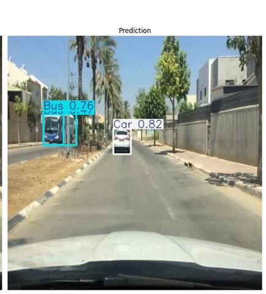](assets/nms/clear-before.jpg) | [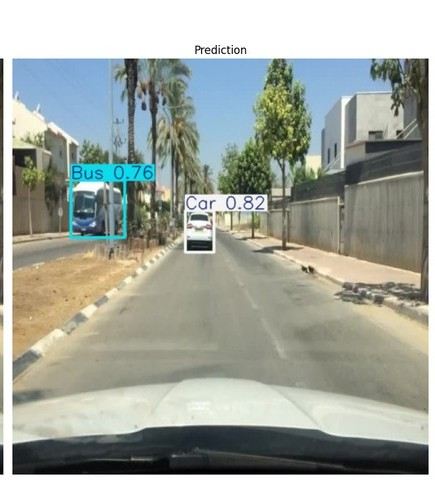](assets/nms/clear-after.jpg) |
| Fog | [](assets/nms/fog-before.jpg) | [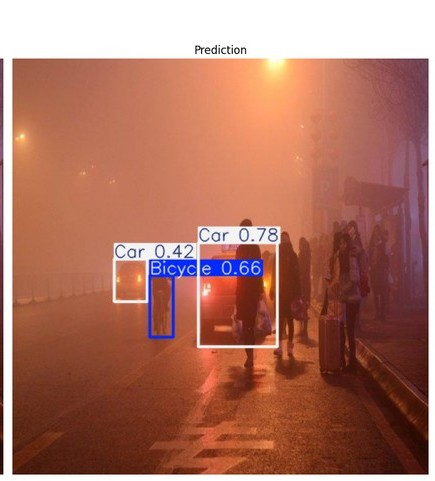](assets/nms/fog-after.jpg) |
| Night | [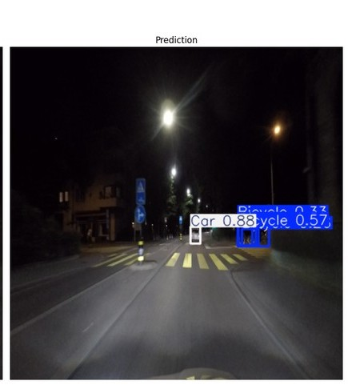](assets/nms/night-before.jpg) | [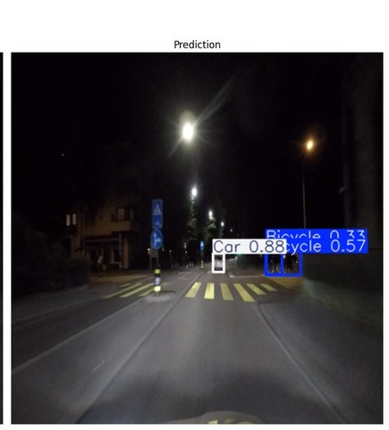](assets/nms/night-after.jpg) |
| Rain | [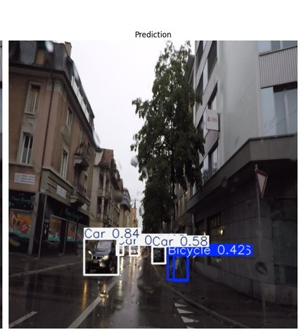](assets/nms/rain-before.jpg) | [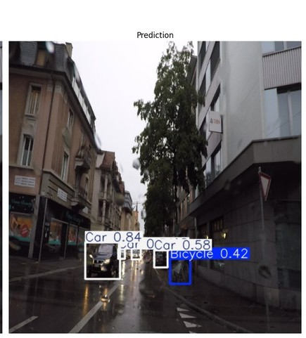](assets/nms/rain-after.jpg) |

## Project Structure

```
├── assets/
│   ├── samples/             # weather sample images (README)
│   └── nms/                 # before/after NMS comparisons (README)
├── best.pt                  # trained YOLO12s weights (imgsz 480)
├── config.py                # shared paths, class map, weather list
├── requirements.txt
├── scripts/
│   ├── 01_prepare_dawn.py   # DAWN → BARD
│   ├── 02_prepare_acdc.py   # ACDC COCO json → YOLO
│   ├── 03_prepare_bdd100k.py# BDD100K json → YOLO
│   ├── 04_prepare_rtts.py   # RTTS VOC xml → YOLO
│   ├── 05_sample.py         # class-balanced sampling per weather
│   ├── 06_split.py          # instance-balanced 70/20/10 split
│   ├── 07_augment.py        # fill minority classes with crops
│   ├── 08_finalize.py       # merge split, resize, write YAML configs
│   ├── 09_train.py          # train YOLO12 n/s/m/x
│   ├── 10_evaluate.py       # val/test, overall + per weather
│   ├── 11_visualize.py      # GT vs prediction panels, metric curves
│   ├── 12_export.py         # ONNX export
│   └── analyze.py           # class-distribution tables
├── app/
│   └── dashcam.py           # real-time dashcam GUI
└── tests/
    └── test_pipeline.py     # synthetic end-to-end pipeline self-check
```

## Getting Started

Requirements: **Python 3.10+** (a GPU is recommended for training, not needed for inference).

```bash
pip install -r requirements.txt
```

All data lives under `data/` (or set the `VD_DATA` environment variable to point elsewhere).
Choose your starting point:

### Option A — combined BARD dataset (skip steps 1–4)

Download the ready-combined dataset from the links above and extract it so the merged
folders sit at `data/BARD/`:

```
data/BARD/
├── images/
│   ├── clear/  fog/  night/  rain/  sand/  snow/
└── labels/          # flat YOLO .txt files, one per image
```

(If the archive extracts under a different top-level folder name, rename/move it
to `data/BARD`.) Then **skip pipeline steps 1–4** and start at step 5.

### Option B — the 4 raw datasets (run everything)

Place each source under `data/` exactly as below, then run steps 1–4 to build
`data/BARD/` yourself. Nothing can be skipped.

```
data/
├── DAWN/{images,labels}
├── gt_detection_trainval/  gt_detection_trainval_ref/  rgb_anon_trainvaltest/   # ACDC
├── bdd100k_labels/100k/  bdd100k_images_100k/100k/
└── RTTS/{Annotations,JPEGImages}
```

## Pipeline (run in order)

| Step | Command | Purpose |
|---|---|---|
| 1 | `python scripts/01_prepare_dawn.py` | DAWN → BARD (class remap + weather folders) |
| 2 | `python scripts/02_prepare_acdc.py` | ACDC COCO json → YOLO |
| 3 | `python scripts/03_prepare_bdd100k.py` | BDD100K json → YOLO |
| 4 | `python scripts/04_prepare_rtts.py` | RTTS VOC xml → YOLO (all fog) |
| — | `python scripts/analyze.py` | weather × class distribution |
| 5 | `python scripts/05_sample.py` | balanced sampling, 400 instances/class/weather |
| 6 | `python scripts/06_split.py` | instance-balanced 70/20/10 split |
| — | `python scripts/analyze.py --split` | verify split counts |
| 7 | `python scripts/07_augment.py` | fill minority classes (train/motorcycle) with crops |
| 8 | `python scripts/08_finalize.py --size 480` | merge main split, resize, write YAML configs |
| 9 | `python scripts/09_train.py --model s` | train YOLO12 (n/s/m/x), results in `runs/` |
| 10 | `python scripts/10_evaluate.py --split val` | validate overall + per weather |
| 10 | `python scripts/10_evaluate.py --split test --conf 0.25 --iou 0.5` | post-NMS test |
| 11 | `python scripts/11_visualize.py --conf 0.25 --iou 0.5` | original / GT / prediction panels |
| 11 | `python scripts/11_visualize.py --curves runs/overall_val` | display metric curves |
| 12 | `python scripts/12_export.py` | export ONNX |

**Which steps can you skip?**

| You have… | Skip | Start at |
|---|---|---|
| Combined BARD dataset (Option A) | steps 1–4 | step 5 |
| The 4 raw datasets (Option B) | nothing | step 1 |
| `BARD/split` + YAML configs already built | steps 1–8 | step 9 |
| Just want to use `best.pt` | everything | dashcam / visualize / export |

> **Tips**
> - For 640/320 input-size variants, copy `BARD/split` and run
>   `08_finalize.py --dir <copy> --size 640`, then train with `09_train.py --imgsz 640`.
> - Quick video inference without any script:
>   `yolo predict model=best.pt source=video.mp4 conf=0.25 iou=0.5 save=True`
> - Verify the pipeline anytime with `python tests/test_pipeline.py`
>   (runs on tiny synthetic data in a temp folder, never touches your data).

## Dashcam App

```bash
python app/dashcam.py                      # webcam
python app/dashcam.py --source video/rain1.mp4
```

A Tkinter desktop app powered by `best.pt`:

- Live bounding boxes with class + confidence, and a running **vehicle count**
- **Measured FPS** display
- **Record** button — saves annotated `.avi` clips to `recordings/`
- Video files loop automatically; falls back to raw frames if detection fails

## Citation

If you use the BARD dataset, please cite:

```bibtex
@misc{Chea_BARD_2025,
  author = {Chea, Ming Shen},
  month  = dec,
  title  = {{BARD}},
  url    = {https://www.kaggle.com/datasets/mingshen0118/bard-vehicle-detection},
  year   = {2025}
}
```

## License

- **Code** (this repository): [MIT](LICENSE)
- **BARD dataset**: [CC-BY-4.0](https://creativecommons.org/licenses/by/4.0/)
- The underlying source datasets (BDD100K, ACDC, RTTS, DAWN) remain under their
  original licenses and terms of use.

---
